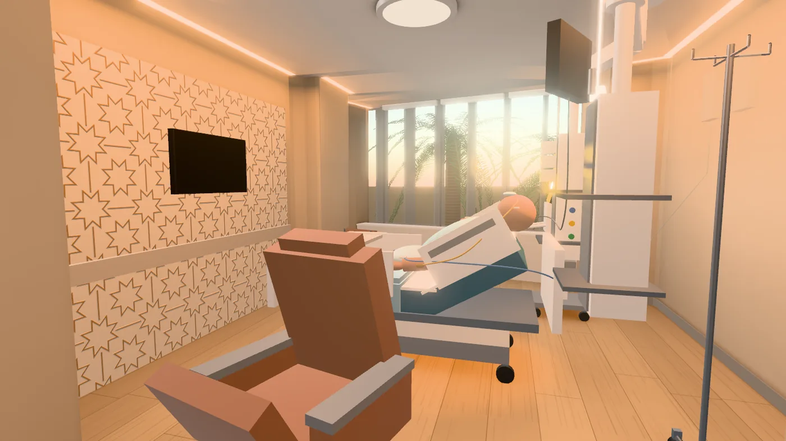
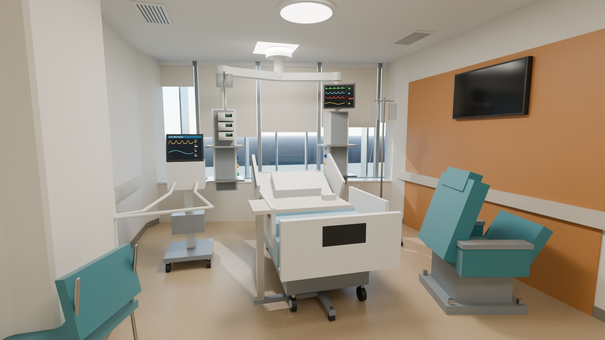
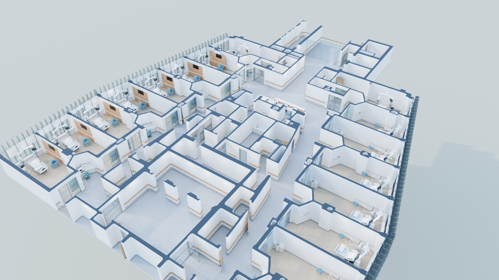
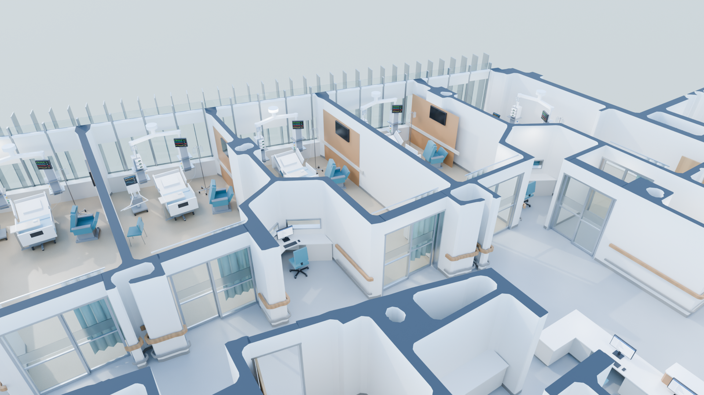
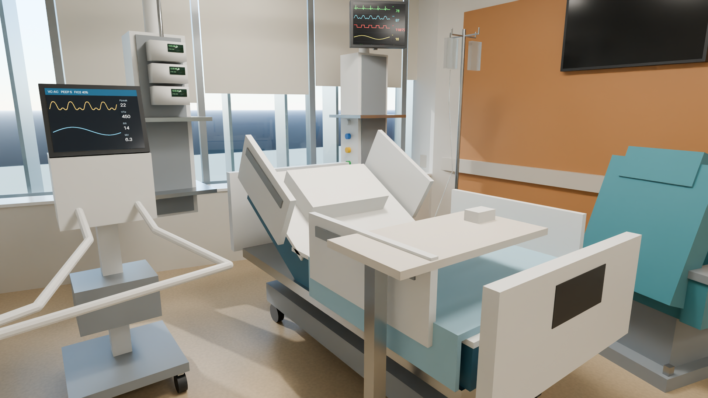
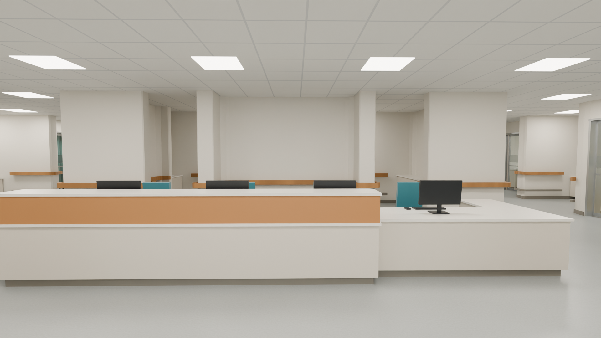
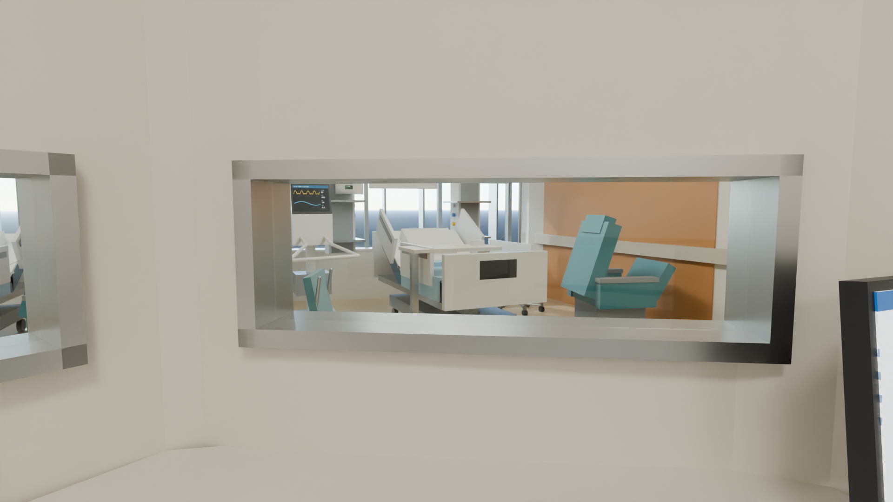
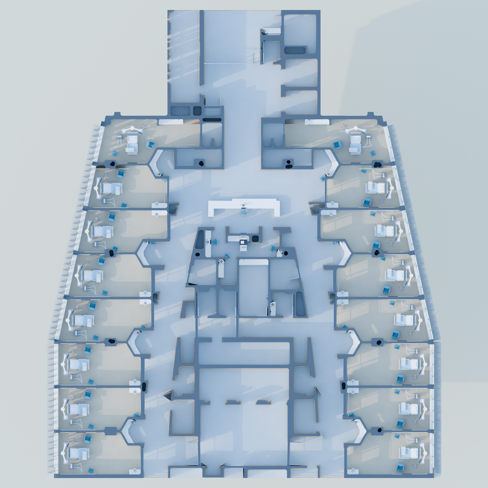
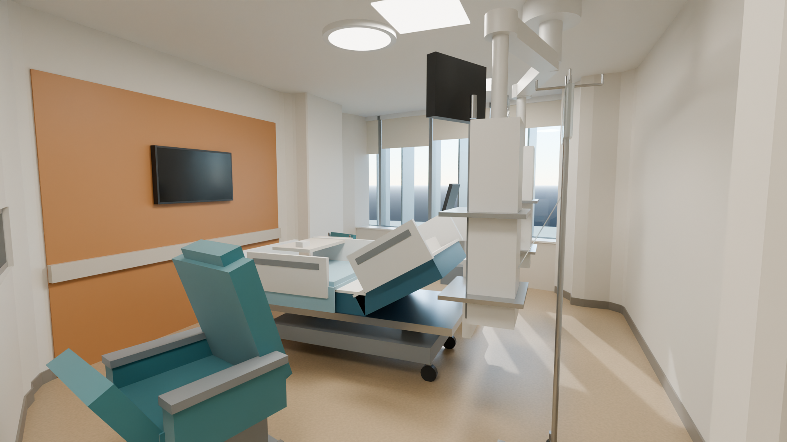
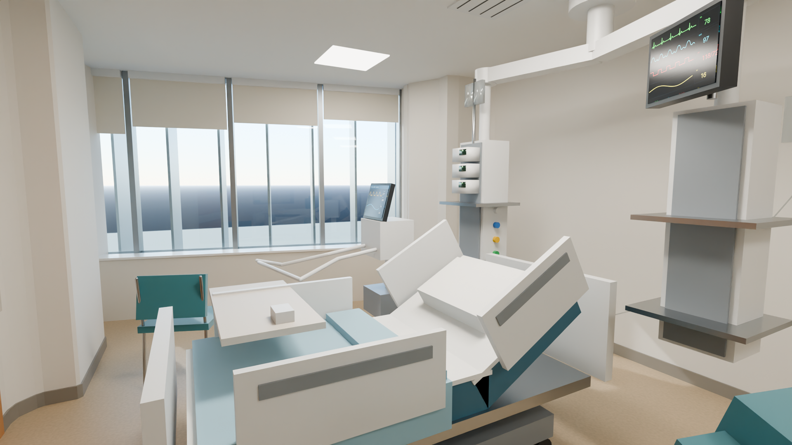

# Adaptive ICU

**A room that adapts to the patient in it.** Adaptive ICU is our proposal for the fourth-floor ICU at Sheikh Shakhbout Medical City (SSMC), made for the SSMC ICU Interior Design Student Competition. It's a patient room that changes its light, blinds and glass with the time of day, the patient's own preferences and the care being given. A nurse approves every change.

**[Open the site](https://ihama1305-design.github.io/ICU-competition/)** · **[Take the 90-second tour](https://ihama1305-design.github.io/ICU-competition/configurator/?tour=guided)** · **[Configure a room](https://ihama1305-design.github.io/ICU-competition/configurator/)** · **[Walk today's floor](https://ihama1305-design.github.io/ICU-competition/viewer/)** · **[See the ventilation plan](https://ihama1305-design.github.io/ICU-competition/ventilation/)** · **[Read the report](REPORT.md)**



## What the room does

Six things this room does that today's doesn't. Each one runs in the [room configurator](https://ihama1305-design.github.io/ICU-competition/configurator/), on the measured shape of rooms W1 and W3.

- **Room modes.** One tap sets the room for Comfort, Privacy, Clinical work or an emergency. The lights, blinds and glass change together. ([More](#configure-a-room))
- **PACS, the Physiological Adaptive Comfort System.** The monitor's readings and the patient's own preferences lead to a suggestion, such as softer light. A nurse approves it before the room changes. ([More](#physiological-adaptive-comfort-system-pacs))
- **APIS, the Adaptive Patient Interface System.** How tubes, lines and sensors sit on the patient: what touches the skin, how each is secured and where it runs, with its clinical limits stated. ([More](#adaptive-patient-interface-system-apis))
- **Patient view.** The room from the pillow, turning only as far as a head can. The screen opposite the bed can show the day, the date and the time.
- **Equipment labels.** Each piece of equipment named, and shaded areas to keep clear for care around the bed. A sketch for discussion, not a compliance check.
- **Remote care for the isolation room.** A sound sensor hears a groan or a call for help and asks the nurse to look in through the glass first, and the air is cleaned in the plant, out of sight. Fewer unnecessary entries, never fewer checks. ([More](#remote-care-for-the-isolation-room))

Every patient reading is simulated: the figures are made up, no microphone is used, and nothing here changes an alarm or a medical device.

## Built on the floor as it is today

The proposal sits on a realistic, walkable 3D model of the existing ICU (Tower D, 4th floor, Part a). The walls, doors, glazing and joinery are read straight from the vector CAD layers of the as-built record drawing. The 16 patient rooms are furnished with a typical ICU kit, and the scene is rendered with Blender Cycles.

The model and walkthrough show the floor as built, as the starting point for the redesign. The configurator is the design proposal, built on top of it. All of it is independent student work, not made or endorsed by SSMC. Furnishings and finishes are assumed; [REPORT.md](REPORT.md) separates what is measured from what is assumed.



## Walk through it

The [walkthrough](https://ihama1305-design.github.io/ICU-competition/viewer/) runs in the browser. Drag **Place person** onto any open floor spot and your view drops to their eye level.

- <kbd>W</kbd> <kbd>A</kbd> <kbd>S</kbd> <kbd>D</kbd> to walk, <kbd>Shift</kbd> to run, drag or arrow keys to look. Touch screens get a joystick that walks forward, back and sideways, a little or a lot, and you drag the view to turn. On a phone every control is on screen in two rows, each big enough to tap; a line over the model says how to move, and **View from behind** sits beside the joystick.
- The page draws only when something changes, so an idle page costs almost nothing. That matters most for a phone's battery.
- **Graphics quality.** A **Quality** control offers Auto, High and Low, and remembers the choice in this browser. High has smoothed edges, glass that bends light (a whole extra render pass) and up to 2 pixels per screen point. Low has neither, with plain see-through glass and up to 1.5. Auto times a few frames after loading and picks; a phone or tablet starts on Low, and you can still choose High. Any device steps its resolution down if it can't keep up. Every feature stays at either tier, and `?tier=low` or `?tier=high` picks one, as on the configurator.
- <kbd>V</kbd> shows the person from behind.
- Walls, counters and the facade stop you. Doors and glass fronts let you through.
- The plan in the corner shows where you are. Click it to jump.
- Click anything to name it and see how sure the model is about it. Rooms W1 and W3 are marked **configurable**, and their card links to that room in the configurator.
- If the browser can't draw 3D (no WebGL 2, or too old for the way the page loads its 3D code), this page and the configurator say so and link to the pictures, instead of loading for ever.
- If the browser drops the 3D view while the page is open (iOS Safari does when memory runs short), both pages stop drawing and say so, with a **Tap to reload the 3D view** button, instead of leaving a frozen picture. The configurator writes its link first, so the reload brings back the same room.

## Configure a room

The [configurator](https://ihama1305-design.github.io/ICU-competition/configurator/) lets you spec one room the way you'd spec a car. Everything on it is a proposal, not the room as built.

- **Rooms:** isolation room W1 with its ante room, or standard room W3.
- **Views:** Overview, Family zone, Entrance, From the bed, Head turned, Window and Dollhouse. Drag to look around, or press <kbd>←</kbd> <kbd>→</kbd> <kbd>↑</kbd> <kbd>↓</kbd> and <kbd>+</kbd> <kbd>-</kbd>. There's also a cinematic tour that starts and ends at the Dollhouse.
- **Patient view:** the camera moves to the pillow and stays there. Drag or use the arrow keys to turn your head, as far as a head can turn, from your own body up to the ceiling. <kbd>+</kbd> <kbd>-</kbd> narrow or widen what you take in. **Return**, or <kbd>Esc</kbd>, goes back to the view you came from.
- **Guided tour:** a button at the top of the panel starts nine captioned steps, about a minute and a half. They cover the room as a proposal, the as-built kit, Patient view, the Comfort, Clinical and Emergency-ready modes with the equipment labels, placing items, and a theme at sunset, and end by pointing to the PACS and APIS demos. Previous, Pause, Next, Restart and Exit are always there; dragging the room pauses it, and with reduced motion it waits for Next. Each step waits nine seconds once its room has stopped moving, and the bar on its card shows the wait. Exit, Finish or Esc puts the room back exactly as it was, and Restart does the same before playing again from the first step. After Finish the card stays to say the tour's changes are undone, with **Try it yourself**, which brings up the room's options, and **Watch again**. The home page's **Take the 90-second tour** button opens the configurator straight into it (`configurator/?tour=guided`).
- **Before and after:** **Compare with today's room** shows every option at its default, with none of your placed items, at the same view and time. Press it again for your room. Your design and its link don't change while it shows, and any change to the room ends the comparison first.
- **Orientation screen:** the TV can show the weekday, the date and the room's own time of day, large enough to read from the bed and darker at night. It shows no patient details.
- **Room modes:** As set, Comfort, Privacy, Clinical and Emergency-ready, in a bar over the room on every screen size. A mode is a scene laid over the room as configured: it never changes a choice, the link or the summary, and As set puts back exactly what was there. Comfort warms and dims the lights and lowers the blinds over about two seconds. Between sunset and sunrise, from the sun's height the room already computes, it leaves the blinds as they are, changes only the lighting and says why in one line; PACS does the same with its blinds recommendation. A small daylight sensor on each room's window sill stands for that reading, and its card gives the sun's height now. Privacy still lowers the blinds after dark, since they're for privacy there. Privacy turns smart glass on the glazed front opaque and lowers the blinds halfway, and staff can end it at any moment. Clinical turns the light up and the examination task light on. Emergency-ready, started by staff, sets full light and the task light, turns the TV and aquarium screen off and clears the glazed front, and its Exit goes back to the mode before it. A chip says clinical alarms are unaffected, and none of this touches the monitor or any medical device. Changing the room's design ends a mode, and PACS, which keeps its own scene, closes when a mode starts.
- **Themes:** Calm Clinical, Desert Sanctuary and Family Suite. Anything can still be changed afterwards.
- **Options:** paint, feature walls, floors, a sky ceiling, four lighting schemes, an examination task light on its own switch, smart glass, blinds, TV, seating, an aquarium, a patio and palms. It's an adult ICU room, so there are no toys or games console. Earlier links that set them still open, without those items.
- **Day and night:** the sun follows a real path at Abu Dhabi's latitude.
- **Equipment labels:** a toggle under the views, which the Clinical and Emergency-ready modes also turn on. It labels the bed, monitor (with its simulated readings), infusion pumps, ventilator, ceiling pendant, examination light, IV pole, the wall controls and anything you've placed. It also hatches keep-clear areas for care beside the bed and at its foot, clipped to the open floor, so whatever stands in them shows. Nothing moves, and the areas carry no dimensions: they're illustrative, not a clinical or compliance check.
- **Place items:** drag a bedside tablet arm, privacy screen, hand-rub dispenser, waste bins, sharps box, biophilic wall panel or compact family chair from the panel onto the room. Floor items stand on open floor, and the dispenser, sharps box and biophilic panel hang on a wall at about 1.2, 1.35 and 1.7 m. The panel is greenery with no soil or water, since living plants stay outside the glass, and its card cites the CDC guidance. You can also choose an item and then click or tap where it goes, and from the keyboard Enter puts it in view. Drag a placed item to move it, and click it to turn or remove it; with its card focused, the arrow keys move it, R turns it and Delete removes it. Placed items go into the link, saved rooms and the summary. Where they go is up to you: staff access, clearances and infection-control positions aren't checked, and each card says so.
- **Saved rooms:** give the room a name and save it, then open, update or delete it later. **Reset the room** puts every choice back to its default. Saved rooms are kept in this browser only and never sent anywhere. If the browser refuses storage, Save says so and nothing else changes.
- **Feature cards:** click a feature in the room, or choose it from the panel's **Features** list, for a card: what it is, how it works, its benefit, how it differs for an awake and a sedated patient, its limits and its evidence. **Explore features**, above the room, marks every feature in view, with a filter by kind. **See it in action** plays a short captioned demo. The wardrobe's card opens it compartment by compartment, and compares it with the freestanding wardrobe it replaced: about the same floor area, worked out from the two models. It shows options without choosing them, so your room and its link don't change, and the room goes back when it ends or when you press Stop or <kbd>Esc</kbd>.
- **Share:** the link holds the exact room. The summary lists every choice with its clinical notes, and you can save an image.

- **Suggest a room:** answer a few questions for an editable comfort and furnishing draft. The panel shows what changed and why, with before-and-after and undo. It never changes the room or recommends care, and answers stay out of links.

To add an option, edit [`scripts/site/configurator/options.json`](scripts/site/configurator/options.json). A new kind of effect also needs a handler in `main.js`. Never renumber a `code` there: share links depend on them.

To add a feature card, add an entry to [`scripts/site/configurator/features.json`](scripts/site/configurator/features.json), and a demo to `demos.js` if it has one. `node scripts/14_check_features.mjs` says what an entry is missing, without a browser.

## Adaptive Patient Interface System (APIS)

Open **Configure a room → Explore APIS**. APIS is an additive educational feature in the existing Three.js configurator, built around the existing W1 and W3 bed metadata. It does not modify the Blender files, exported room geometry, dimensions, room options, patient-profile answers or share-code format. The separate WASD walkthrough remains intact.

- Six selectable attachment examples: NG feeding tube, IV securement, respiratory interface, respiratory strap contact, ECG electrode and urinary catheter securement. Enable the bedside markers to click them in the room, or select an example by keyboard in APIS.
- Opening an attachment focuses the room camera and shows a rotatable 3D schematic. Compare conventional/proposed arrangements, explode the layers and select a layer to highlight its purpose. Closing APIS or pressing Escape restores the room view.
- The material library distinguishes soft silicone adhesive, silicone-contact multilayer foam, molded silicone elastomer and TPE. Foam's absorbent layer is polyurethane; the four materials are not interchangeable.
- The tubing tab compares illustrative line routes during bed movement and patient turning. It addresses clutter, snagging, tension, bends, displacement concerns and access during repositioning. It does not alter the modeled bed or calculate forces, flow, pressure or safety.
- Established material uses and clinical principles are distinguished from experimental APIS external guides. IV sterile dressings and ECG conductive contacts are retained; external guides are shown away from skin. Added padding may increase pressure or compromise fit. Benefits are conditional design intentions, not measured APIS outcomes.

Clinical references appear beside the examples: the [2025 International Guideline](https://www.internationalguideline.com/drpi), CDC guidance for [IV devices](https://www.cdc.gov/infection-control/hcp/intravascular-catheter-related-infections/summary-recommendations.html) and [urinary catheters](https://www.cdc.gov/infection-control/hcp/cauti/summary-of-recommendations.html), and manufacturer material information. The supplied feature brief ended mid-sentence; APIS conservatively preserves device fit, function, securement, inspection and device-specific instructions. These are schematic adult-scale examples, not pediatric device selection or clinical instructions.

Source files: `scripts/site/configurator/apis.js`, `apis-data.js` and `apis.css`, with small integration points in `main.js` and `configurator.template.html`. The existing `06_build_site.py` publishes them. The committed `configurator/` copies are kept in sync so the static site can run without rebuilding Blender. No new runtime package or backend is needed.

The inspected checkout contains patient bed views, general room views, clickable equipment, patient comfort profiles and profile before/after comparison. APIS does not remove or replace any existing control.

The focused browser check is `node scripts/11_check_apis.mjs` (install Playwright with `npm install --prefix build/apis-tools playwright`; uses installed Chrome/Edge when available). It serves the site under a repository subpath and writes review screenshots to `build/shots/`.

Verification performed: W1 and W3 attachment interactions, real bedside-marker clicks, layer comparisons/highlights/explosion, material and routing views, camera/ceiling restoration, all existing camera presets, themes, day/night, profile before/after and undo, summary, tour, share-code reload, mobile overflow and keyboard focus, plus original walkthrough movement and object picking. The final NG illustration received a focused rerun. Browser checks found no uncaught JavaScript errors or missing local assets. Source/published copies, JavaScript syntax and whitespace checks passed. The full Blender/Python pipeline was not rerun: this environment has no installed Python, and the required intermediate build inputs are absent. The room model was not rebuilt.

## Physiological Adaptive Comfort System (PACS)

Open **Configure a room → PHYSIOLOGICAL ADAPTIVE MODE**, or **START PHYSIOLOGICAL ADAPTIVE DEMO** for the approximately 77-second presentation. PACS runs in the same Three.js room and renderer; there is no separate replacement scene, backend, medical-device connection or real clinical notification.

- **Three scenarios:** Stable Patient starts at HR 78 bpm, BP 118/76 mmHg, RR 16/min and SpO₂ 98%. Possible Discomfort illustrates HR increasing toward 105 over 12 seconds, alongside other scripted changes; it prompts assessment, not a diagnosis. Clinical Deterioration activates an independently scripted warning and a simulated team notification. No emergency thresholds are calculated from these values. Scenario selection loads a new scripted case and starting environment; it is not a physiological trigger for automatic environmental changes.
- **Clinical oversight:** A simulated clinical review and explicit nurse approval are required for selected recommendations. Rejecting applies no new adjustment. Revising an in-progress proposal cancels its remaining animation and requires fresh approval; withdrawing clinical review also cancels it. Preferences invalidate old approval. Clinical warnings cancel pending comfort animation, restore entry lighting for assessment, and block new recommendations. Acknowledging the alert leaves it active. Oxygen, ventilator, medication, infusion and medical-alarm controls are not changed.
- **Room response:** The existing patient monitor receives a temporary simulated display; existing ceiling/ambient lights and blinds respond smoothly. The existing sound indicator reflects a simulated nonessential-audio setting; no sound plays, no microphone is used, and alarm volume is never controlled. Exiting restores original monitor materials, lighting, blinds, sound-indicator color, camera, options and share state.
- **Preferences and feedback:** A separate fictional comfort profile records lighting, color, audio, blinds and a preferred temperature range. Hospital-approved temperature limits are absent, so temperature is review-only. Brightness percentages describe rendered light output, not comfort, stress, measured illuminance or approved hospital limits. HRV is unavailable, movement observations are scripted, and sleep is not inferred. Patient improvement/no improvement/unable-to-respond feedback remains independent of physiological readings.
- **Comparison and presentation:** Before/after uses a locked camera. Conventional ICUs retain their monitoring and manual controls; the proposed innovation is integration and oversight. The guided presentation has Next, Previous, Pause/Resume, Restart and Exit; nurse approval is explicitly role-played in presentation mode. The alert remains active at the end.

### Shared patient, line organization and click labels

A clothed adult-scale patient figure follows the existing bed and raised backrest. `patient.js` supplies shared attachment landmarks to APIS and PACS, avoiding duplicate attachment geometry. External extensions meet the existing modeled respiratory and IV tubing; ECG, enteral and urinary routes are separately labeled and visually organized. The enteral endpoint is a separate capped schematic connector, never an IV connection. Urinary drainage descends to a bag below the illustrated bladder and above the floor. These are illustrative routes, not validated circuit lengths, securement, bend radii or clinical placement instructions.

Every new patient component, attachment, tube route and PACS connection has click-to-inspect information through the existing object card. Attachment cards link to APIS. PACS temporarily hides APIS inspection markers and restores their previous visibility on exit. Conceptual information connections run above the physical tubing and can be hidden; **Patient & line routes** provides a clear inspection view. Original room dimensions, bed geometry, equipment, WASD walkthrough, comfort profiles and their comparisons remain intact.

Sources linked in the dashboard include [SCCM PADIS](https://www.sccm.org/clinical-resources/guidelines/guidelines/guidelines-for-the-prevention-and-management-of-pa), [NICE CG103](https://www.nice.org.uk/guidance/cg103/chapter/Recommendations) and [CDC environmental air guidance](https://www.cdc.gov/infection-control/hcp/environmental-control/air.html). They support assessment and environmental-care principles; they do not establish clinical effectiveness of PACS. Automated discomfort inference, physiological comfort prediction, AI personalization and HRV-triggered automation are labeled experimental and are not implemented as clinical decision algorithms.

PACS source is split into `pacs-state.js` (scenarios and approval rules), `pacs-scene.js` (reversible room bindings), `pacs.js` (dashboard and presentation), `pacs.css`, and shared `patient.js`, under `scripts/site/configurator/`. The existing site build copies these into `configurator/`; published copies are synchronized. Tests: `node scripts/12_check_pacs_state.mjs`, `node scripts/13_check_pacs.mjs`, and `node scripts/13_check_pacs.mjs --extended-only`. Browser screenshots are saved in `build/shots/`.

Verification performed: PACS state/approval rules; W1 and W3 monitor displays, lighting/blinds, selected adjustments, rejection, independent feedback, preference invalidation, clinical alert priority, reset, same-camera comparison, and exact room/camera/share restoration. Manual presentation navigation, mobile layout, preference dialogs and Escape handling passed. The automatic 11-step presentation completed in 77.4 seconds on the final run (79.7 seconds on the earlier run), with the alert still active. Browser checks verified patient click labels, interruption of an actual lighting/blind transition by a scripted warning, and cancellation when a proposal is revised/rejected or clinical review is withdrawn. The full APIS regression also passed after patient integration: all six examples in both rooms, real bedside-marker clicks, layers/materials/routing, original views, themes, day/night, profiles and comparisons, summary, tour, sharing, mobile controls, and original WASD/object picking. No uncaught browser errors or missing local assets were reported. Source/published parity, JavaScript syntax and whitespace checks passed. Original model assets and dimensions were unchanged; the Blender/Python rebuild was not run.

## Remote care for the isolation room

**Fewer unnecessary entries, never fewer checks.** Every entry to isolation room W1 costs protective clothing and opens the door of a negative-pressure room, so the room helps staff see, hear and know from outside. The glazed front already lets them see. Two concept features add the rest, and both are simulated:

- **Hear: a vocal-distress cue.** In the [configurator](https://ihama1305-design.github.io/ICU-competition/configurator/), open *Comfort systems* or click the sound sensor on the wall, then press *Simulate a call for help* or *Simulate a groan*. The sensor's light changes and a notice marked SIMULATED asks the nurse to look in through the glass, and leaves going in to them. It stays until acknowledged. No microphone is used, nothing is recorded or stored, and no alarm or device changes. The sensor's card lists the limits: ventilated or sedated patients may make no sound, alarms cause false alerts, and a real sensor would classify sounds on the device and never store them.
- **Clean: a clean-air layer.** The [ventilation plan](https://ihama1305-design.github.io/ICU-competition/ventilation/#clean-air) has a table of filters and UV-C in the air handling plant, each row with its basis, and the wall comfort control's card shows the same rows for its room. Nothing is added to the room, and fogging, ozone and ionisers aren't proposed.

A unit board that ranks patients by their vitals was the third idea. It isn't built: REPORT.md says why.

## Ventilation concept

The [ventilation plan](https://ihama1305-design.github.io/ICU-competition/ventilation/) shows supply, return and exhaust grilles for the floor, with the air-change and pressure basis for each kind of room. **It's concept work, not SSMC's mechanical design:** the drawings show no grilles, ducts or air data. The grilles are hidden in the walkthrough, the renders and the configurator for now, so the plan is the only place they show. The model still builds them, hidden, from the same list.

The plan also has a clean-air table: two filter stages on the supply, a HEPA-filtered exhaust from the isolation rooms, and UV-C in the plant as an extra. It's all out of sight, with no new grilles, and it doesn't propose fogging, ozone or ionisers. In the configurator, clicking the wall comfort control shows the same rows for that room.

## Renders

| | |
|---|---|
|  |  |
| The whole floor with the ceiling off | Close cutaway of the west wing |
|  |  |
| At the bedside (made-up readings, each screen marked SIMULATED) | The central nurse station from the corridor |
|  |  |
| Into a patient room through an observation window | Top view |
|  |  |
| Isolation room W1 along its length | W1's bed, with the window beside the patient |

## Files

| File | What it is |
|---|---|
| [`downloads/icu.blend`](downloads/icu.blend) | Editable Blender 5.2 scene with collections Shell, Ceiling, Facade, Doors, Glazing, Joinery, Equipment, Lights, Cameras |
| [`downloads/icu.glb`](downloads/icu.glb) | The same model for other 3D tools (metres, Y-up, flat colours) |
| [`renders/`](renders/) | Full-size Cycles renders |
| [`REPORT.md`](REPORT.md) | How it was built, what is accurate and what is assumed |
| [`spec/icu_spec.json`](spec/icu_spec.json) | Every height, material, equipment position, light and camera ([field guide](spec/icu_spec.README.md)) |
| [`scripts/`](scripts/) | The pipeline, from drawing to website |
| `index.html`, `viewer/`, `configurator/`, `ventilation/`, `assets/` | The published website, served from the repo root. It is generated, so edit `scripts/site/` and rebuild instead |
| [`docs/`](docs/) | The configurator's brief and build plan |

## Rebuild

```bash
python3.13 -m venv .venv && .venv/bin/python -m pip install -r requirements.txt
.venv/bin/python -m playwright install chromium
scripts/run_all.sh            # about 20 minutes on an M-series Mac, most of it testing; --preview for quick renders
```

The pipeline runs 01 extract plan, 02 Blender scene, 09 fixture check, 10 ventilation plan, 03 renders, 04 GLB and viewer, 05 viewer test, 07 configurator rooms, 06 website, then 08 configurator test. 07 has to come before 06, which publishes what it writes. 05 and 08 need a network connection, because Three.js comes from a CDN.

Change a number in `spec/icu_spec.json` and run `scripts/run_all.sh` again. A rebuild replaces `output/icu.blend`, so save your own Blender edits under another name.

## The drawings are not in this repo

`input/` is git-ignored, because the SSMC record drawings were shared with competition entrants and this repo is public. To rebuild, put the four PDFs from *SSMC ICU Design Competition - Reference Drawings v1.zip* in `input/drawings/`.
