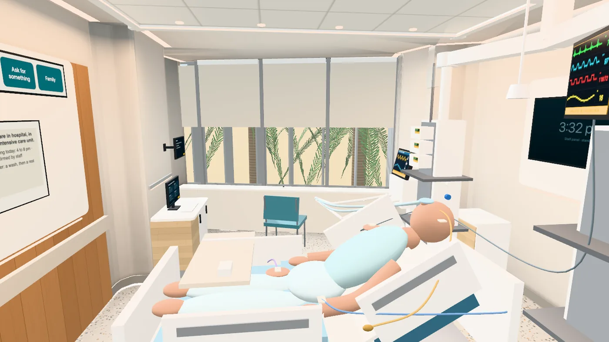
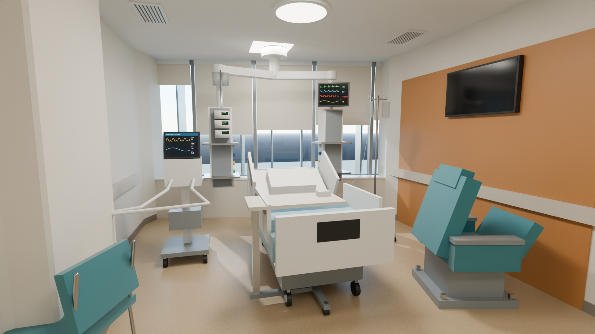
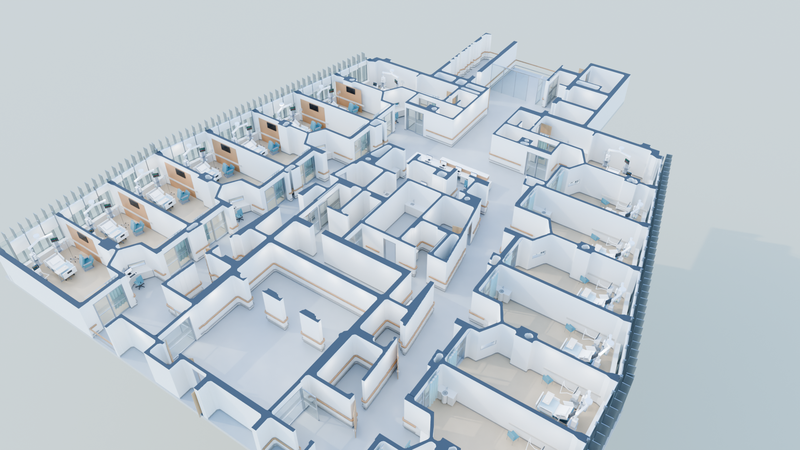
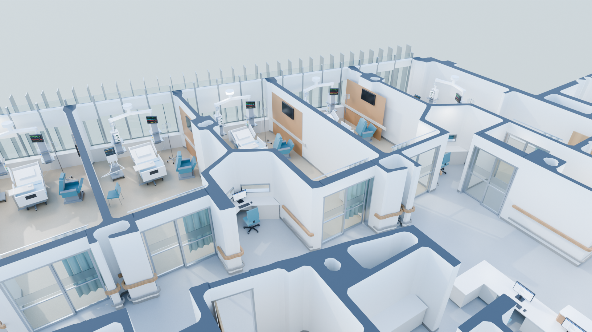
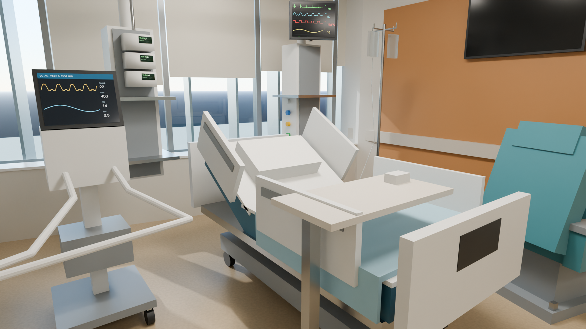
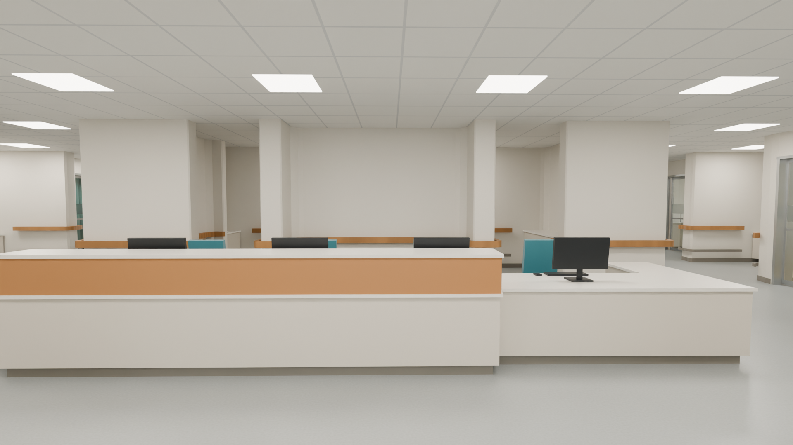
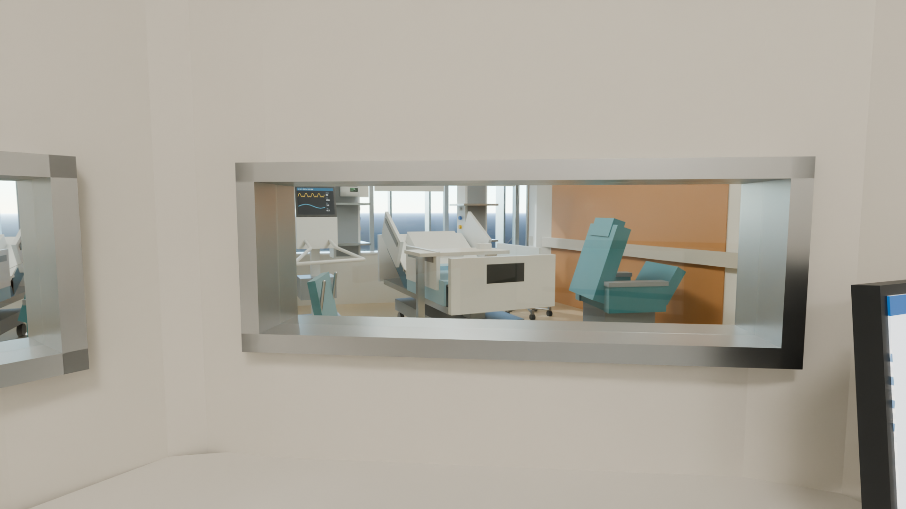
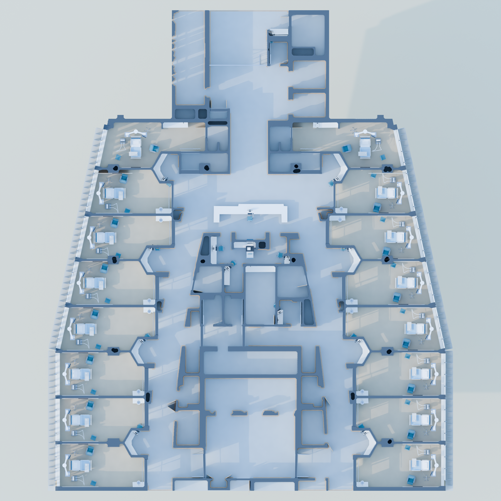
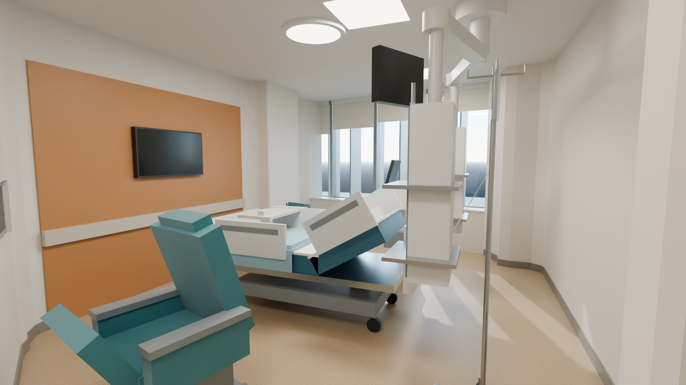
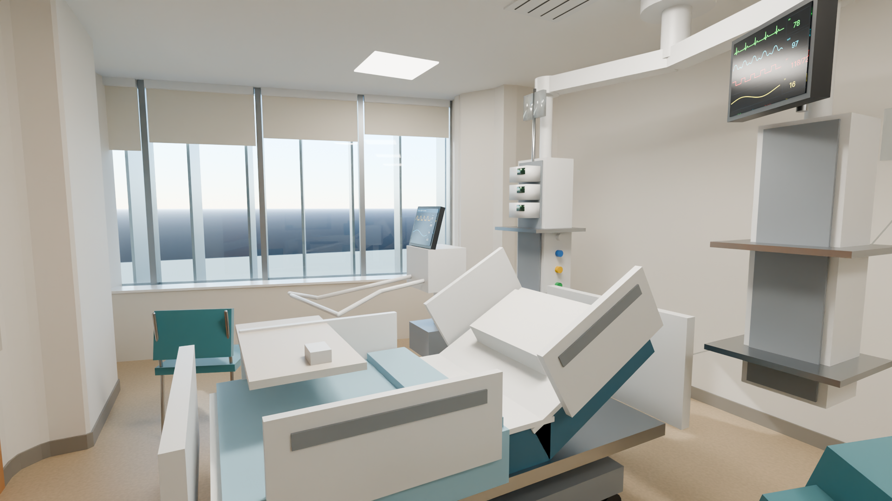

# Adaptive ICU

**A room that adapts to the patient in it.** Adaptive ICU is our proposal for the fourth-floor ICU at Sheikh Shakhbout Medical City (SSMC), made for the SSMC ICU Interior Design Student Competition. It's a patient room that changes its light, blinds and glass with the time of day, the patient's own preferences and the care being given. A nurse approves every change.

**[Open the site](https://ihama1305-design.github.io/ICU-competition/)** · **[Experience the ICU of the future](https://ihama1305-design.github.io/ICU-competition/configurator/?tour=future)** · **[Configure a room](https://ihama1305-design.github.io/ICU-competition/configurator/)** · **[Walk today's floor](https://ihama1305-design.github.io/ICU-competition/viewer/)** · **[See the ventilation plan](https://ihama1305-design.github.io/ICU-competition/ventilation/)** · **[Read the report](REPORT.md)**



## What the room does

Six things this room does that today's doesn't. Each one runs in the [room configurator](https://ihama1305-design.github.io/ICU-competition/configurator/), on the measured shape of rooms W1 and W3.

- **Room modes.** One tap sets the room for Comfort, Privacy, Clinical work, a family visit, cleaning between patients or an emergency. The lights, blinds, glass, wall screens and scenes change together. ([More](#configure-a-room))
- **PACS, the Physiological Adaptive Comfort System.** The monitor's readings and the patient's own preferences lead to a suggestion, such as softer light. A nurse approves it before the room changes. ([More](#physiological-adaptive-comfort-system-pacs))
- **APIS, the Adaptive Patient Interface System.** How tubes, lines and sensors sit on the patient: what touches the skin, how each is secured and where it runs, with its clinical limits stated. ([More](#adaptive-patient-interface-system-apis))
- **Patient view.** The room from the pillow, turning only as far as a head can. The screen opposite the bed can show the day, the date and the time.
- **Equipment labels.** Each piece of equipment named, and shaded areas to keep clear for care around the bed. A sketch for discussion, not a compliance check.
- **Remote care for the isolation room.** A sound sensor hears a groan or a call for help and asks the nurse to look in through the glass first, and the air is cleaned in the plant, out of sight. Fewer unnecessary entries, never fewer checks. ([More](#remote-care-for-the-isolation-room))

Every patient reading is simulated: the figures are made up, no microphone is used, and nothing here changes an alarm or a medical device. [Every feature and its status](#every-feature-and-its-status) lists what each one is and isn't, and what isn't built. To present it, follow [the judges' script](docs/judges-script.md).

## Built on the floor as it is today

The proposal sits on a realistic, walkable 3D model of the existing ICU (Tower D, 4th floor, Part a). The walls, doors, glazing and joinery are read straight from the vector CAD layers of the as-built record drawing. The 16 patient rooms are furnished with a typical ICU kit, and the scene is rendered with Blender Cycles.

The model and walkthrough show the floor as built, as the starting point for the redesign. The configurator is the design proposal, built on top of it. All of it is independent student work, not made or endorsed by SSMC. Furnishings and finishes are assumed; [REPORT.md](REPORT.md) separates what is measured from what is assumed.



## Walk through it

The [walkthrough](https://ihama1305-design.github.io/ICU-competition/viewer/) runs in the browser. Drag **Place person** onto any open floor spot and your view drops to their eye level.

- <kbd>W</kbd> <kbd>A</kbd> <kbd>S</kbd> <kbd>D</kbd> to walk, <kbd>Shift</kbd> to run, drag or arrow keys to look. Touch screens get a joystick that walks forward, back and sideways, a little or a lot, and you drag the view to turn. On a phone every control is on screen in two rows, each big enough to tap; a line over the model says how to move, and **View from behind** sits beside the joystick.
- The page draws only when something changes, so an idle page costs almost nothing. That matters most for a phone's battery.
- **Graphics quality.** A **Quality** control offers Auto, High and Low, and remembers the choice in this browser. High has smoothed edges, glass that bends light (a whole extra render pass) and up to 2 pixels per screen point. Low has neither, with plain see-through glass and up to 1.5. Auto times a few frames after loading and picks; a phone or tablet starts on Low, and you can still choose High. Any device steps its resolution down if it can't keep up. Every feature stays at either tier, and `?tier=low` or `?tier=high` picks one, as on the configurator.
- <kbd>V</kbd> shows the person from behind.
- Walls, counters and the facade stop you. Doors and glass fronts let you through.
- The plan in the corner shows where you are. Click it to jump.
- Click anything to name it and see how sure the model is about it. Rooms W1 and W3 are marked **configurable**, and their card links to that room in the configurator.
- If the browser can't draw 3D (no WebGL 2, or too old for the way the page loads its 3D code), this page and the configurator say so and link to the pictures, instead of loading for ever.
- If the browser drops the 3D view while the page is open (iOS Safari does when memory runs short), both pages stop drawing and say so, with a **Tap to reload the 3D view** button, instead of leaving a frozen picture. The configurator writes its link first, so the reload brings back the same room.

## Configure a room

The [configurator](https://ihama1305-design.github.io/ICU-competition/configurator/) lets you spec one room the way you'd spec a car. Everything on it is a proposal, not the room as built.

- **Rooms:** isolation room W1 with its ante room, or standard room W3.
- **Views:** Overview, Family zone, Entrance, From the bed, Head turned, Window, Dollhouse and Across the room. Drag to look around, or press <kbd>←</kbd> <kbd>→</kbd> <kbd>↑</kbd> <kbd>↓</kbd> and <kbd>+</kbd> <kbd>-</kbd>. There's also a cinematic tour that starts and ends at the Dollhouse.
- **Patient view:** the camera moves to the pillow and stays there. Drag or use the arrow keys to turn your head, as far as a head can turn, from your own body up to the ceiling. <kbd>+</kbd> <kbd>-</kbd> narrow or widen what you take in. **Return**, or <kbd>Esc</kbd>, goes back to the view you came from.
- **Experience the ICU of the future:** the main button at the top of the panel, and the home page's first, starts one patient's story in eight captioned steps, about two minutes: entering the room in the Future ICU look; comfort, with a forest scene and Comfort mode; the patient asking for water on the communication board, the tour playing the patient; the pendant and each line's clip, tag and slack; the wall turned to Clinical and a task at the workstation; Family visit moving the light, glass, screens and scenes together; today's room, typical rather than every ICU, becoming the new one piece by piece; and Iham's closing lines. It runs on the same engine as the nine-step tour, with the same controls, and Finish puts the room back exactly, the patient's request and the opened panels included (`configurator/?tour=future`).
- **Room basics (the nine-step tour):** a smaller button under it starts the first guided tour's nine captioned steps, about a minute and a half. They cover the room as a proposal, the as-built kit, Patient view, the Comfort, Clinical and Emergency modes with the equipment labels, placing items, and a theme at sunset, and end by pointing to the PACS and APIS demos. Previous, Pause, Next, Restart and Exit are always there; dragging the room pauses it, and with reduced motion it waits for Next. Each step waits nine seconds once its room has stopped moving, and the bar on its card shows the wait. Exit, Finish or Esc puts the room back exactly as it was, and Restart does the same before playing again from the first step. After Finish the card stays to say the tour's changes are undone, with **Try it yourself**, which brings up the room's options, and **Watch again**. Its link still opens it (`configurator/?tour=guided`).
- **Before and after:** **Before / after** shows every option at its default, with none of your placed items, at the same view and time. Press it again for your room. Your design and its link don't change while it shows, and any change to the room ends the comparison first. **Transform the ICU**, beside it, plays the same comparison as a short story: today's room, a typical arrangement rather than every ICU, then the Future ICU's pieces arriving one at a time (the floor and the light, the ceiling tray, the wall screens, the desk and the cabinet, a scene, and a mode moving them together), and the visitor's own room back at the end. Its last caption says the difference is how the room works, not only how it looks.
- **Orientation screen:** the TV can show the weekday, the date and the room's own time of day, large enough to read from the bed and darker at night. It shows no patient details.
- **Room modes:** As set, Comfort, Privacy, Clinical, Family visit, Cleaning and Emergency, in a bar over the room on every screen size (on a phone, two rows of three with Emergency below). One table in `modes.js` says what each mode does to the light, blinds, glass, wall screens, scenes, sound, bedside screens, notices and overlays, and five levels of priority settle any clash, highest first: clinical safety and emergency access, what staff have switched on, patient communication, patient comfort preferences, and decoration. A lower level never overrides a higher one. Each mode's note says in one line what changed, and that medical alarms always stay on. **Family visit** warms the light, softens smart glass to a frost as the patient's passport asks (staff can still see in), and puts family connection on the patient wall. **Cleaning**, for a room between patients, empties the bed, turns the light up and the screens off, and brings up a checklist that lights each high-touch surface, hand-hygiene point and piece of equipment in turn; finishing it says the checklist is finished, never that the room is disinfected, and it links to the ventilation plan rather than drawing airflow. A mode is a scene laid over the room as configured: it never changes a choice, the link or the summary, and As set puts back exactly what was there. Comfort warms and dims the lights and lowers the blinds over about two seconds. Between sunset and sunrise, from the sun's height the room already computes, it leaves the blinds as they are, changes only the lighting and says why in one line; PACS does the same with its blinds recommendation. A small daylight sensor on each room's window sill stands for that reading, and its card gives the sun's height now. Privacy still lowers the blinds after dark, since they're for privacy there. Privacy turns smart glass on the glazed front opaque and lowers the blinds halfway, and staff can end it at any moment. Clinical turns the light up and the examination task light on. Emergency, started by staff, sets full light and the task light, turns the TV and aquarium screen off and clears the glazed front, and its Exit goes back to the mode before it. A chip says clinical alarms are unaffected, and none of this touches the monitor or any medical device. Changing the room's design ends a mode, and PACS, which keeps its own scene, closes when a mode starts.
- **Themes:** Future ICU, Calm Clinical, Desert Sanctuary and Family Suite. Anything can still be changed afterwards. A link with no code still opens Calm Clinical, today's room.
- **Options:** paint, feature walls, floors, a sky ceiling, four lighting schemes, an examination task light on its own switch, smart glass, blinds, TV, seating, an aquarium, a patio and palms. It's an adult ICU room, so there are no toys or games console. Earlier links that set them still open, without those items.
- **Day and night:** the sun follows a real path at Abu Dhabi's latitude.
- **Equipment labels:** a toggle under the views, which the Clinical and Emergency modes also turn on. It labels the bed, monitor (with its simulated readings), infusion pumps, ventilator, ceiling pendant, examination light, IV pole, the wall controls and anything you've placed. It also hatches keep-clear areas for care beside the bed and at its foot, clipped to the open floor, so whatever stands in them shows. Nothing moves, and the areas carry no dimensions: they're illustrative, not a clinical or compliance check.
- **Place items:** drag a bedside tablet arm, privacy screen, hand-rub dispenser, waste bins, sharps box, biophilic wall panel or compact family chair from the panel onto the room. Floor items stand on open floor, and the dispenser, sharps box and biophilic panel hang on a wall at about 1.2, 1.35 and 1.7 m. The panel is greenery with no soil or water, since living plants stay outside the glass, and its card cites the CDC guidance. You can also choose an item and then click or tap where it goes, and from the keyboard Enter puts it in view. Drag a placed item to move it, and click it to turn or remove it; with its card focused, the arrow keys move it, R turns it and Delete removes it. Placed items go into the link, saved rooms and the summary. Where they go is up to you: staff access, clearances and infection-control positions aren't checked, and each card says so.
- **Saved rooms:** give the room a name and save it, then open, update or delete it later. **Reset the room** puts every choice back to its default. Saved rooms are kept in this browser only and never sent anywhere. If the browser refuses storage, Save says so and nothing else changes.
- **Feature cards:** click a feature in the room, or choose it from the panel's **Features** list, for a card: what it is, how it works, its benefit, how it differs for an awake and a sedated patient, its limits and its evidence. **Explore features**, above the room, marks every feature in view, with a filter by kind. **See it in action** plays a short captioned demo. The wardrobe's card opens it compartment by compartment, and compares it with the freestanding wardrobe it replaced: about the same floor area, worked out from the two models. It shows options without choosing them, so your room and its link don't change, and the room goes back when it ends or when you press Stop or <kbd>Esc</kbd>.
- **Acoustic comfort mode:** a button above the room shows the room's sound as a picture: six simulated sources with the two loudest at the pillow marked, a sound map on the floor, a quiet zone round the bed, and the room without and then with four acoustic fittings. It lists the three kinds of notification, and critical alarms stay out of its reach. Every level is illustrative. **Play demo sound** plays the noisy room and then the quieter one; it's off until you press it, quiet, made in the page, and it stops on <kbd>Esc</kbd>, for Emergency or for any notice. Nothing listens: no microphone is ever asked for.
- **Patient states and bedside screens:** a Patient bar under the room modes sets the patient as Sedated, Awake or Recovering. The light eases to suit, and the patient's screen goes quiet or shows the orientation screen first. **Bedside screens** opens a communication board of eleven requests in English and Arabic (touch, a simulated single switch, or simulated gaze, with a nurse-side list; a nurse can turn on Privacy from a privacy request), a sample comfort passport saved only in this browser, family connection with staff's **Quiet now**, and the staff view. All simulated: nothing is sent, and no alarm or device is changed.
- **Light across 24 hours:** under Time of day, a 24-hour timeline to drag through four phases (morning daylight, afternoon comfort, evening wind-down and night sleep). The room shows the circadian light and the blinds at that hour, every change gradual, and quiet hours are marked. **Play the day** runs through once and stops. Clinical and Emergency always win, the link doesn't change, and closing it puts the time back.
- **The bed: pressure and lines:** for staff, a simulated pressure map on the mattress marks where a position has been held past the sample plan's interval, with a **Positioning assessment due** reminder staff dismiss. **Lines** shows a clip and colour tag on each line round the patient, and each line's slack in the chosen position; any move first asks staff to check the lines. The bed and figure don't move, nothing is measured, and no line or device is changed.
- **The Future ICU look:** the Future ICU theme sets soft white and warm timber, a pale terrazzo floor, circadian light and half-down blinds, and turns on five new fittings, each also an option of its own under **Future ICU fittings**, off by default: a lit **ceiling tray** over the bed, a **staff panel** on the wall behind the bed head, a **patient wall** round the TV, a **clinician workstation** by the window and a **bedside cabinet**. Their screens follow the smart clinical wall, below; the patient monitor stays on its pendant, working. **Across the room** looks at the room from the front, toward the window. One layout check confirms in both rooms that no fitting overlaps anything or stands in a keep-clear area, a door's way, the wardrobe's front or the walking route to the bed: these areas are this model's own and illustrative, so it means no modelled conflict was found, not that a room is safe.
- **The smart clinical wall:** one switch under **Smart clinical wall** for the staff panel and the patient wall: **Clinical** (made-up heart rate, oxygen saturation, blood pressure, breathing rate and temperature, care tasks and equipment for staff, marked simulated, beside the bedside monitor, which keeps running with its alarms unchanged), **Patient** (the orientation screen, the care team by role, the day's plan, and two buttons that open the communication board and family connection) or **Relaxation** (a scene across the wall). The room's modes move it without changing the choice: Clinical to Clinical, Comfort to Relaxation, and Emergency turns the patient wall and every scene off. A sedated patient gets no buttons. **Transform my environment** sets the patient wall, the ceiling above the bed and the room's light together from seven scenes drawn in code (forest, ocean, mountains, desert, garden, clear sky, night sky), slowly, and Off goes back to how the room was. The **clinician workstation** opens a made-up dashboard with no name or diagnosis: Nurse view and Doctor view, tasks that light where their things are in the room and tick off with Done, hands-free buttons that stand in for spoken commands (nothing listens, and nothing is said aloud), where supplies are kept, and in Emergency where the emergency equipment is and the clear route to the bed, marked on the floor. That view isn't a validated emergency protocol. It opens PACS as it is.
- **The digital twin:** **Open the digital twin** reads the room's hidden state from the room as it is. Seven systems, each read in words and lit in the room when chosen: the bed, the ceiling with its sensors and light, the walls with their screens, privacy and comfort control, storage, equipment, the floor and its clear areas (with the route to the bed), and the mode in force with its row of the mode table. Above them, room health in five separate parts, each saying whether there's anything to look at: environmental comfort, equipment organisation, access clearance, communication readiness and the cleaning checklist. Change the mode, the patient's state or a choice and it reads again. It never adds the parts into a total, shows no vital signs (those are PACS's), and monitors nothing: every value is one the room already has, simulated or illustrative.
- **Room intelligence:** three flush sensors on the ceiling, an option under **Room intelligence** (code 45, off by default, on in Future ICU): over the bed, inside the door and over the middle of the room. **Open room intelligence** and activate it to see the floor each would cover, then raise two made-up events by button: the patient moving toward the edge of the bed, and something left in a clear area. Each lights its place and puts a notice in front of staff and on the clinician workstation, which stays until a person acknowledges it; Reset takes the events away. Nothing watches or listens, it changes no alarm or device, and it isn't AI: a concept for decision support, not a validated clinical device.
- **Room safety scan:** under Place items, it runs the layout check the Future ICU fittings passed on the room as the visitor has arranged it: each placed item against the keep-clear areas, the space in front of each door, the wardrobe's front, the route to the bed, and everything solid. Green says no modelled conflict found, amber a clearance to look at, red an overlap, always in words too. Choosing a result explains it, lights the item and marks a nearby clear spot on the floor; the visitor moves it, and the scan runs again. The areas are this model's own: green never means safe, and it isn't a compliance check.
- **Equipment and cables:** the ceiling pendant has its card. **Cable channels** (code 46, off by default, on in Future ICU) are flush covers on the ceiling and the wall behind the bed head, one for power and data and a separate one for medical gas, with a docking spot marked where the ventilator stands. Under **Equipment and cables**, **Traditional** shows today's arrangement, power, data and gas cables loose on the floor, and **Organised** routes them through the channels and down the pendant, with nothing on the floor; each kind has a label in the room as well as a colour. The patient's own lines are the bed's clips and tags and APIS's Tubing & movement, which a button opens as it is. Nothing retracts, clamps or disconnects a line, nothing moves by itself, and the routes are illustrative.
- **Share:** the link holds the exact room. The summary lists every choice with its clinical notes, and you can save an image.

- **Suggest a room:** answer a few questions for an editable comfort and furnishing draft. The panel shows what changed and why, with before-and-after and undo. It never changes the room or recommends care, and answers stay out of links.

To add an option, edit [`scripts/site/configurator/options.json`](scripts/site/configurator/options.json). A new kind of effect also needs a handler in `main.js`. Never renumber a `code` there: share links depend on them.

To add a feature card, add an entry to [`scripts/site/configurator/features.json`](scripts/site/configurator/features.json), and a demo to `demos.js` if it has one. `node scripts/14_check_features.mjs` says what an entry is missing, without a browser.

## Every feature and its status

One row per feature, from the same registry as the feature cards, plus the parts of the site that aren't cards and what isn't built. "What it isn't" is the start of each card's limits; the card has the rest, with its evidence.

**Status:** *Concept* is shown in the 3D room as a design; a real one would need engineering, infection-control and clinical review. *Simulated* runs on the site with made-up data or events; nothing real is connected, measured or sent. *Tool* does real work on this model: a tour, a check, a plan or a link. *Not built* is listed so nobody looks for it.

| Group | Feature | What it does | What it isn't | Status |
|---|---|---|---|---|
| Comfort | Privacy system | Privacy at the glazed front and the window when the patient needs it. Staff can end it at once. | Opaque glass hides the patient from the corridor, so staff decide when it's used. In an isolation room the door still needs its seal and pressure tests. | Concept |
| Comfort | Patient orientation display | The TV can show the weekday, the date, the time of day and whether it's day or night, with a few calm lines beside them: where the patient is, visiting confirmed by staff, and what's planned. Large enough to read from the bed. | It makes no claim about delirium or sleep. The lines are samples: a real screen would show only what staff have confirmed, and never patient details. | Simulated |
| Comfort | Nature and environmental display | Calm, natural things to look at from the bed: a scene on the TV, a sky on the ceiling, a digital aquarium and a printed leaf panel. | Emergency turns the screens off. Living plants and fish tanks stay out of patient-care areas, as CDC guidance advises. | Concept |
| Comfort | Patient states | The room follows the patient: sedated or unresponsive, awake, or recovering. A control above the room, beside the room modes. | Staff decide the state: the room never works it out from the patient. It changes no alarm, device or clinical setting, and it changes no choice or link. | Simulated |
| Comfort | Communication board | Large buttons for a patient who can't speak: I need help, I am in pain, I feel cold, I feel hot, I need repositioning, I want to contact my family, I need a nurse. | Simulated. It does not replace a certified nurse-call system: a real one is wired, tested and maintained to its own standard. | Simulated |
| Comfort | Personal comfort passport | A sample record of what a patient would like: light, temperature, music or quiet, a nature scene, family photographs, privacy, how they communicate, and entertainment. | A sample for a made-up patient, with no name. Temperature is shown, not applied: no approved limits were supplied. | Simulated |
| Comfort | Sound-level sensor | A closed door keeps a patient's voice in. This sensor concept gives that hearing back: it would recognise a groan or a call for help and put a notice in front of the nurse outside, who looks in through the glass before deciding to enter. | Simulated here, with no microphone. Patients on a breathing machine or sedated may not make sounds, and alarms can set it off. It doesn't replace the nurse call. | Simulated |
| Comfort | Room comfort control | A wall-mounted temperature and humidity control concept. It is not connected to room equipment or patient measurements. | No hospital-approved temperature limits were supplied, so nothing is set from here. Cleaning the air is the plant room's job. | Concept |
| Comfort | Acoustic comfort mode | A picture of the room's sound: where it comes from, where it's loudest, and what acoustic fittings would change. Simulated. | Not a measurement: no microphone is used, and nothing listens. Every level is illustrative, and the fittings' effect is made up. | Simulated |
| Comfort | Patient wall | The wall the patient faces, made into one calm surface round the TV. | Simulated: no real names, plans or times. Whether the strip can be read from the pillow depends on the patient's eyesight; Patient view shows the distance. | Simulated |
| Comfort | Transform my environment | Bringing the outside world into intensive care: the patient chooses a forest, the ocean, mountains, the desert, a garden, a clear sky or a night sky, and the room takes it on. | Drawn scenes, not footage, and a concept: it makes no claim about sleep, delirium or recovery. Living plants stay outside the glass. | Concept |
| Bed | Pressure-awareness bed | A sensor grid in the mattress shows where the patient's weight bears, so staff can see when a position has been held too long. Simulated. | Simulated: not a measurement. It predicts no injury, and it never moves a patient: staff assess and reposition by the patient's own positioning plan. | Simulated |
| Bed | Line clips and tags | A clip on each line's route round the patient, with a tag in its colour, and each line's slack shown before a move. Simulated. | Simulated: no tension, force or flow is worked out, and no line or device is monitored. The clips don't secure a line, and nothing here changes a real line, connector or device. | Simulated |
| Light | Adaptive circadian lighting | Room light that follows the day: cool and bright by day, warm and dim in the evening. | Light alone isn't shown to prevent delirium. Care comes first: Clinical and Emergency modes switch to full, neutral light. | Concept |
| Light | Light across 24 hours | A plan for the room's light and blinds over a whole day, in four phases: morning daylight, afternoon comfort, evening wind-down and night sleep. | A plan, not a measurement, and light alone isn't shown to prevent delirium. Clinical and Emergency are the staff override and always win. | Concept |
| Light | Daylight sensor | A small light sensor on the window sill. It tells Comfort mode and PACS whether daylight is coming in. | A concept: it isn't connected to anything, and it reads nothing here. | Concept |
| Light | Ceiling tray | A calm ceiling over the bed: square tiles in a shallow tray, with a soft line of light round its edge. | A design concept. In this model its light adds no brightness: the room's own lights do that. | Concept |
| Family | Family connection | Family close by on the bedside screens: photographs, a video call, a voice message, a personal scene, familiar music and a line on the orientation screen. | No photograph is uploaded, no camera or microphone is used, and nothing is sent. A real call would need the hospital's approved system. | Simulated |
| Family | Family visit | A mode for when family come: the room warms, privacy is as the patient asked, and family connection is on the wall they face. | Simulated: the photographs are drawn placeholders and the message is made up. Softened glass is a concept: a real front needs its privacy level and staff sight lines agreed with the care team. | Simulated |
| Storage | Built-in sliding wardrobe | Compact, organised storage for the patient's clothing, belongings and daily necessities, built in floor to ceiling against the back wall, clear of the entry route. | It takes about the same floor area as the freestanding wardrobe it replaced: what it adds is height, easier cleaning and a tidier look. A design concept: no inventory display or electronic lock is modelled. | Concept |
| Storage | Bedside cabinet | A place near the bed for the patient's own small things: glasses, a phone, a book. | A design concept. Clinical supplies are kept apart from it. | Concept |
| Clinical workflow | Staff panel | Information for the care team on the wall behind the bed head, where staff look and the patient can't. | Simulated: its values are made up and fixed, not readings, and it never stands in for the patient monitor, which stays on the pendant, working, with its alarms unchanged. A real one needs integration, infection-control and regulatory review. | Simulated |
| Clinical workflow | Clinician workstation | A desk for the care team in the room, by the window and out of the space round the bed. | Simulated: a made-up patient, made-up values and a scripted task list. Nothing listens: each hands-free button stands in for a spoken command. | Simulated |
| Clinical workflow | Smart clinical wall | One wall, more than one purpose: the staff panel and the patient wall show what each person needs now. Staff get observations, tasks and equipment; the patient gets the day, the time, the care team and the plan; at rest, a calm scene. | Simulated: every value is made up and fixed, and the staff panel never stands in for the bedside monitor, which keeps running with its alarms unchanged. Observations show only in Clinical, so visitors don't see them. | Simulated |
| Clinical workflow | Room modes | The room changes together: one choice of mode moves the light, the blinds, the glass, the wall screens, scenes, sound, the bedside screens, notices and overlays, in step. | A demonstration of the idea. No mode touches an alarm, a medical device or the bedside monitor. | Simulated |
| Clinical workflow | Cleaning | A mode for the room between patients: bright light, the bed empty, and the surfaces that are touched most marked one after another. | An order to show the idea, not a cleaning protocol: products, contact times and the order of work are the infection-control team's. Finishing the checklist says it's finished, and never that the room is clean or disinfected. | Simulated |
| Clinical workflow | Transform the ICU | Today's room, then the room of the future arriving a piece at a time: the difference is how the room works, not only how it looks. | Today's room is a typical arrangement, not every ICU, and the equipment is a typical ICU kit, not SSMC's inventory. A demo: it changes no choice or link. | Tool |
| Clinical workflow | Digital twin | A digital reflection of the room: its hidden state made visible, so the space, equipment, environment and work can be seen together. | A concept: it reads only this model, with its simulated and illustrative values, and monitors nothing. The five parts are never added into a score, and it shows no vital signs, which are PACS's. | Simulated |
| Clinical workflow | Room intelligence | A room that notices when help may be needed: it would help staff see a possible safety concern while keeping the room calm and uncluttered. | A concept for monitoring and decision support, not a validated clinical device. Nothing watches or listens: no camera, no microphone and no sensor reading; every event is a button. | Simulated |
| Clinical workflow | Room safety scan | Check a room digitally before it's built: the items a visitor places, against the space that care needs. | The areas are this model's own, set as data and illustrative: green means no modelled conflict found, never that a room is safe, and it isn't a compliance check against hospital rules. | Tool |
| Clinical workflow | Ceiling pendant | Ceiling services: the monitor, the pumps and the outlets hang from the ceiling at the bed head, so the floor round the bed stays clearer and the essentials are within reach. | A visual model of a pendant, not a specified product. Its position, load, services and the ceiling's structure would need engineering, infection-control and clinical review. | Concept |
| Clinical workflow | Cables and channels | Less clutter, better access and safer movement: the cables and lines round the bed shown by kind, loose and then organised. | Illustrative routes, not an engineering or clinical design. Nothing retracts, clamps or disconnects a line, and nothing moves by itself. | Concept |
| The site | Configurator | Rooms W1 and W3 on their measured shape: four themes, every finish, light and fitting as an option, the time of day, ten views, a share link that holds the exact room, a summary and an image. | A design proposal, not a construction or procurement drawing. Furniture and finishes are assumed. | Tool |
| The site | Experience the ICU of the future | One patient's story in eight captioned steps, about two minutes, from the main button and the home page. | A tour of this proposal: the patient is played by the tour, and every value is made up. | Tool |
| The site | Room basics | The first guided tour, nine captioned steps, about a minute and a half, at `?tour=guided`. | A tour of the room's basics, not of the Future ICU. | Tool |
| The site | Before / after | Every option at its default, with none of the placed items, at the same view and time. Press again for the room as designed. | Today's room is a typical arrangement, not every ICU. | Tool |
| The site | Patient view | The room from the pillow, turning only as far as a head can. | Eyesight differs: it shows what is in view, not what a patient can read. | Tool |
| The site | Equipment labels | Names each piece of equipment and shades the space to keep clear for care round the bed. | A sketch for discussion, not a compliance check. The areas carry no dimensions. | Tool |
| The site | Place items | Drag a tablet arm, privacy screen, hand rub, bins, sharps box, biophilic panel or family chair onto the room. | A visitor's sketch: the room safety scan checks it against this model's own clear areas, not hospital rules. | Tool |
| The site | Suggest a room | A few questions about the patient give an editable comfort and furnishing draft, with what changed and why, and undo. | A design suggestion: it never recommends care, and the answers stay out of links. | Tool |
| Clinical systems | PACS, the Physiological Adaptive Comfort System | Simulated vital signs and the patient's preferences lead to a suggestion, such as softer light. A nurse approves it before the room changes. | Not connected to a monitor: every reading is made up and scripted. It never controls an alarm or a device, and infers no diagnosis. | Simulated |
| Clinical systems | APIS, the Adaptive Patient Interface System | An idea for a gentler way to attach tubes, wires and sensors: what touches the skin, how each is held, where it runs, and its limits. | An idea, not a device: the approved device and its own instructions come first, and no force, flow or pressure is worked out. | Concept |
| The floor today | Walkthrough | The fourth-floor ICU as built, from the record drawing, to walk through. Click anything to see what it is and how sure we are about it. | Furnishings and finishes are assumed. Not for medical or construction use. | Tool |
| The floor today | Ventilation plan | Supply, return and exhaust for the floor, the pressure steps from corridor to entry room to bedroom, and a clean-air table. | Concept work, not SSMC's mechanical design: the values are assumed, from Dubai Health Authority guidance. | Concept |
| Not built | Ceiling lift | A track hoist over the bed for moving a patient, from Iham's list. | Not built: there wasn't time before the 16 November freeze. | Not built |
| Not built | Admission and room readiness | A board that follows a room from the last patient's discharge to the next one's arrival. Cleaning mode's checklist would be its first stage. | Not built: there wasn't time before the 16 November freeze. | Not built |
| Not built | Unit board | A board ranking the unit's patients by their vital signs. | Not built, by decision: this site ranks no one and gives no single score. REPORT.md says why. | Not built |

## How the room stays in step

Every system in the room listens to one table, in [`modes.js`](scripts/site/configurator/modes.js), rather than to each other. For each room mode it says, in words, what the mode does to the light, the blinds, the glazed front, the wall screens, the scenes, sound, the bedside screens, notices and overlays, and at which of five levels:

1. Clinical safety and emergency access
2. What staff have switched on
3. Patient communication
4. Patient comfort preferences
5. Decoration and presentation

| | Comfort | Privacy | Clinical | Family visit | Cleaning | Emergency |
|---|---|---|---|---|---|---|
| **Light** | Warm and dim (2) | as set | Full and neutral, with the task light (2) | Warm ambient (2) | Bright, for cleaning (2) | Full, with the task light (1) |
| **Blinds** | Lowered by day; after sunset as set (2) | Halfway down (2) | as set | as set | as set | as set |
| **Glazed front** | as set | Smart glass opaque (2) | as set | Softened, as the patient asked; staff can still see in (4) | Clear (2) | Clear (1) |
| **Wall screens** | Relaxation: a scene (2) | as set | Clinical: the staff panel's made-up observations (2) | Family connection on the patient wall (3) | Off: no patient (2) | Patient wall off; staff panel clinical (1) |
| **Scenes** | as set | as set | as set | as set | Off (2) | Off (1) |
| **Sound** | as set | as set | as set | as set | Demo sound stops (2) | Demo sound stops (1) |
| **Bedside screens** | as set | as set | as set | Family connection offered (3) | Closed: no patient (2) | Panels in the options' place close (1) |
| **Notices** | as set | as set | as set | as set | as set | Critical alarms as they always are (1) |
| **Overlays** | as set | as set | Equipment labels and keep-clear areas (2) | as set | High-touch surfaces in turn, hand-hygiene points, equipment to clean, and a checklist (2) | Equipment labels and keep-clear areas (1) |

When two things claim the same system, the higher level wins, and a lower level never overrides a higher one. That's why Clinical and Emergency always win over a scene, a patient's state, Light across 24 hours or a theme. Leaving a mode puts the room back as it was set: no mode changes a choice or a link. Medical alarms are in no row: no mode can touch them. Check 14 tests the table, its levels and the rule.

## Adaptive Patient Interface System (APIS)

Open **Configure a room → Explore APIS**. APIS is an additive educational feature in the existing Three.js configurator, built around the existing W1 and W3 bed metadata. It does not modify the Blender files, exported room geometry, dimensions, room options, patient-profile answers or share-code format. The separate WASD walkthrough remains intact.

- Six selectable attachment examples: NG feeding tube, IV securement, respiratory interface, respiratory strap contact, ECG electrode and urinary catheter securement. Enable the bedside markers to click them in the room, or select an example by keyboard in APIS.
- Opening an attachment focuses the room camera and shows a rotatable 3D schematic. Compare conventional/proposed arrangements, explode the layers and select a layer to highlight its purpose. Closing APIS or pressing Escape restores the room view.
- The material library distinguishes soft silicone adhesive, silicone-contact multilayer foam, molded silicone elastomer and TPE. Foam's absorbent layer is polyurethane; the four materials are not interchangeable.
- The tubing tab compares illustrative line routes during bed movement and patient turning. It addresses clutter, snagging, tension, bends, displacement concerns and access during repositioning. It does not alter the modeled bed or calculate forces, flow, pressure or safety.
- Established material uses and clinical principles are distinguished from experimental APIS external guides. IV sterile dressings and ECG conductive contacts are retained; external guides are shown away from skin. Added padding may increase pressure or compromise fit. Benefits are conditional design intentions, not measured APIS outcomes.

Clinical references appear beside the examples: the [2025 International Guideline](https://www.internationalguideline.com/drpi), CDC guidance for [IV devices](https://www.cdc.gov/infection-control/hcp/intravascular-catheter-related-infections/summary-recommendations.html) and [urinary catheters](https://www.cdc.gov/infection-control/hcp/cauti/summary-of-recommendations.html), and manufacturer material information. The supplied feature brief ended mid-sentence; APIS conservatively preserves device fit, function, securement, inspection and device-specific instructions. These are schematic adult-scale examples, not pediatric device selection or clinical instructions.

Source files: `scripts/site/configurator/apis.js`, `apis-data.js` and `apis.css`, with small integration points in `main.js` and `configurator.template.html`. The existing `06_build_site.py` publishes them. The committed `configurator/` copies are kept in sync so the static site can run without rebuilding Blender. No new runtime package or backend is needed.

The inspected checkout contains patient bed views, general room views, clickable equipment, patient comfort profiles and profile before/after comparison. APIS does not remove or replace any existing control.

The focused browser check is `node scripts/11_check_apis.mjs` (install Playwright with `npm install --prefix build/apis-tools playwright`; uses installed Chrome/Edge when available). It serves the site under a repository subpath and writes review screenshots to `build/shots/`.

Verification performed: W1 and W3 attachment interactions, real bedside-marker clicks, layer comparisons/highlights/explosion, material and routing views, camera/ceiling restoration, all existing camera presets, themes, day/night, profile before/after and undo, summary, tour, share-code reload, mobile overflow and keyboard focus, plus original walkthrough movement and object picking. The final NG illustration received a focused rerun. Browser checks found no uncaught JavaScript errors or missing local assets. Source/published copies, JavaScript syntax and whitespace checks passed. The full Blender/Python pipeline was not rerun: this environment has no installed Python, and the required intermediate build inputs are absent. The room model was not rebuilt.

## Physiological Adaptive Comfort System (PACS)

Open **Configure a room → OPEN NURSE DASHBOARD**, or **PLAY THE 77-SECOND DEMO** for the approximately 77-second presentation. PACS runs in the same Three.js room and renderer; there is no separate replacement scene, backend, medical-device connection or real clinical notification.

- **Three scenarios:** Stable Patient starts at HR 78 bpm, BP 118/76 mmHg, RR 16/min and SpO₂ 98%. Possible Discomfort illustrates HR increasing toward 105 over 12 seconds, alongside other scripted changes; it prompts assessment, not a diagnosis. Clinical Deterioration activates an independently scripted warning and a simulated team notification. No emergency thresholds are calculated from these values. Scenario selection loads a new scripted case and starting environment; it is not a physiological trigger for automatic environmental changes.
- **Clinical oversight:** A simulated clinical review and explicit nurse approval are required for selected recommendations. Rejecting applies no new adjustment. Revising an in-progress proposal cancels its remaining animation and requires fresh approval; withdrawing clinical review also cancels it. Preferences invalidate old approval. Clinical warnings cancel pending comfort animation, restore entry lighting for assessment, and block new recommendations. Acknowledging the alert leaves it active. Oxygen, ventilator, medication, infusion and medical-alarm controls are not changed.
- **Room response:** The existing patient monitor receives a temporary simulated display; existing ceiling/ambient lights and blinds respond smoothly. The existing sound indicator reflects a simulated nonessential-audio setting; no sound plays, no microphone is used, and alarm volume is never controlled. Exiting restores original monitor materials, lighting, blinds, sound-indicator color, camera, options and share state.
- **Preferences and feedback:** A separate fictional comfort profile records lighting, color, audio, blinds and a preferred temperature range. Hospital-approved temperature limits are absent, so temperature is review-only. Brightness percentages describe rendered light output, not comfort, stress, measured illuminance or approved hospital limits. HRV is unavailable, movement observations are scripted, and sleep is not inferred. Patient improvement/no improvement/unable-to-respond feedback remains independent of physiological readings.
- **Comparison and presentation:** Before/after uses a locked camera. Conventional ICUs retain their monitoring and manual controls; the proposed innovation is integration and oversight. The guided presentation has Next, Previous, Pause/Resume, Restart and Exit; nurse approval is explicitly role-played in presentation mode. The alert remains active at the end.

### Shared patient, line organization and click labels

A clothed adult-scale patient figure follows the existing bed and raised backrest. `patient.js` supplies shared attachment landmarks to APIS and PACS, avoiding duplicate attachment geometry. External extensions meet the existing modeled respiratory and IV tubing; ECG, enteral and urinary routes are separately labeled and visually organized. The enteral endpoint is a separate capped schematic connector, never an IV connection. Urinary drainage descends to a bag below the illustrated bladder and above the floor. These are illustrative routes, not validated circuit lengths, securement, bend radii or clinical placement instructions.

Every new patient component, attachment, tube route and PACS connection has click-to-inspect information through the existing object card. Attachment cards link to APIS. PACS temporarily hides APIS inspection markers and restores their previous visibility on exit. Conceptual information connections run above the physical tubing and can be hidden; **Patient & line routes** provides a clear inspection view. Original room dimensions, bed geometry, equipment, WASD walkthrough, comfort profiles and their comparisons remain intact.

Sources linked in the dashboard include [SCCM PADIS](https://www.sccm.org/clinical-resources/guidelines/guidelines/guidelines-for-the-prevention-and-management-of-pa), [NICE CG103](https://www.nice.org.uk/guidance/cg103/chapter/Recommendations) and [CDC environmental air guidance](https://www.cdc.gov/infection-control/hcp/environmental-control/air.html). They support assessment and environmental-care principles; they do not establish clinical effectiveness of PACS. Automated discomfort inference, physiological comfort prediction, AI personalization and HRV-triggered automation are labeled experimental and are not implemented as clinical decision algorithms.

PACS source is split into `pacs-state.js` (scenarios and approval rules), `pacs-scene.js` (reversible room bindings), `pacs.js` (dashboard and presentation), `pacs.css`, and shared `patient.js`, under `scripts/site/configurator/`. The existing site build copies these into `configurator/`; published copies are synchronized. Tests: `node scripts/12_check_pacs_state.mjs`, `node scripts/13_check_pacs.mjs`, and `node scripts/13_check_pacs.mjs --extended-only`. Browser screenshots are saved in `build/shots/`.

Verification performed: PACS state/approval rules; W1 and W3 monitor displays, lighting/blinds, selected adjustments, rejection, independent feedback, preference invalidation, clinical alert priority, reset, same-camera comparison, and exact room/camera/share restoration. Manual presentation navigation, mobile layout, preference dialogs and Escape handling passed. The automatic 11-step presentation completed in 77.4 seconds on the final run (79.7 seconds on the earlier run), with the alert still active. Browser checks verified patient click labels, interruption of an actual lighting/blind transition by a scripted warning, and cancellation when a proposal is revised/rejected or clinical review is withdrawn. The full APIS regression also passed after patient integration: all six examples in both rooms, real bedside-marker clicks, layers/materials/routing, original views, themes, day/night, profiles and comparisons, summary, tour, sharing, mobile controls, and original WASD/object picking. No uncaught browser errors or missing local assets were reported. Source/published parity, JavaScript syntax and whitespace checks passed. Original model assets and dimensions were unchanged; the Blender/Python rebuild was not run.

## Remote care for the isolation room

**Fewer unnecessary entries, never fewer checks.** Every entry to isolation room W1 costs protective clothing and opens the door of a negative-pressure room, so the room helps staff see, hear and know from outside. The glazed front already lets them see. Two concept features add the rest, and both are simulated:

- **Hear: a vocal-distress cue.** In the [configurator](https://ihama1305-design.github.io/ICU-competition/configurator/), open *Comfort systems* or click the sound sensor on the wall, then press *Simulate a call for help* or *Simulate a groan*. The sensor's light changes and a notice marked SIMULATED asks the nurse to look in through the glass, and leaves going in to them. It stays until acknowledged. No microphone is used, nothing is recorded or stored, and no alarm or device changes. The sensor's card lists the limits: ventilated or sedated patients may make no sound, alarms cause false alerts, and a real sensor would classify sounds on the device and never store them.
- **Clean: a clean-air layer.** The [ventilation plan](https://ihama1305-design.github.io/ICU-competition/ventilation/#clean-air) has a table of filters and UV-C in the air handling plant, each row with its basis, and the wall comfort control's card shows the same rows for its room. Nothing is added to the room, and fogging, ozone and ionisers aren't proposed.

A unit board that ranks patients by their vitals was the third idea. It isn't built: REPORT.md says why.

## Ventilation concept

The [ventilation plan](https://ihama1305-design.github.io/ICU-competition/ventilation/) shows supply, return and exhaust grilles for the floor, with the air-change and pressure basis for each kind of room. **It's concept work, not SSMC's mechanical design:** the drawings show no grilles, ducts or air data. The grilles are hidden in the walkthrough, the renders and the configurator for now, so the plan is the only place they show. The model still builds them, hidden, from the same list.

The plan also has a clean-air table: two filter stages on the supply, a HEPA-filtered exhaust from the isolation rooms, and UV-C in the plant as an extra. It's all out of sight, with no new grilles, and it doesn't propose fogging, ozone or ionisers. In the configurator, clicking the wall comfort control shows the same rows for that room.

## Renders

| | |
|---|---|
|  |  |
| The whole floor with the ceiling off | Close cutaway of the west wing |
|  |  |
| At the bedside (made-up readings, each screen marked SIMULATED) | The central nurse station from the corridor |
|  |  |
| Into a patient room through an observation window | Top view |
|  |  |
| Isolation room W1 along its length | W1's bed, with the window beside the patient |

## Files

| File | What it is |
|---|---|
| [`downloads/icu.blend`](downloads/icu.blend) | Editable Blender 5.2 scene with collections Shell, Ceiling, Facade, Doors, Glazing, Joinery, Equipment, Lights, Cameras |
| [`downloads/icu.glb`](downloads/icu.glb) | The same model for other 3D tools (metres, Y-up, flat colours) |
| [`renders/`](renders/) | Full-size Cycles renders |
| [`REPORT.md`](REPORT.md) | How it was built, what is accurate and what is assumed |
| [`spec/icu_spec.json`](spec/icu_spec.json) | Every height, material, equipment position, light and camera ([field guide](spec/icu_spec.README.md)) |
| [`scripts/`](scripts/) | The pipeline, from drawing to website |
| `index.html`, `viewer/`, `configurator/`, `ventilation/`, `assets/` | The published website, served from the repo root. It is generated, so edit `scripts/site/` and rebuild instead |
| [`docs/`](docs/) | The judges' script, the real-device checklist, and the configurator's brief and build plan |

## Run it locally

The site is static files in the repo root, so any web server will do:

```bash
python3 -m http.server 8000
```

Then open http://localhost:8000/ for the home page, or http://localhost:8000/configurator/ for the room. The configurator loads Three.js from a CDN, so it needs a network connection.

## How it's published

GitHub Pages serves the repo root of `main` at https://ihama1305-design.github.io/ICU-competition/, so a merge to `main` is a release. The published files (`index.html`, `configurator/`, `viewer/`, `ventilation/`, `assets/`) are generated: edit their sources under `scripts/site/` and rebuild with the pipeline below, or with `scripts/06_build_site.py` when the Blender outputs are in place. After a merge, Pages takes a minute or two.

## Testing

Everything was tested automatically in Chromium on one Mac. **Safari, Firefox and real phones have never been tested.** [REPORT.md](REPORT.md#what-was-tested-and-what-wasnt) says exactly what each check covers and what wasn't tested, and [`docs/real-device-checklist.md`](docs/real-device-checklist.md) is the list to work through on a real device.

## Rebuild

```bash
python3.13 -m venv .venv && .venv/bin/python -m pip install -r requirements.txt
.venv/bin/python -m playwright install chromium
scripts/run_all.sh            # about 20 minutes on an M-series Mac, most of it testing; --preview for quick renders
```

The pipeline runs 01 extract plan, 02 Blender scene, 09 fixture check, 10 ventilation plan, 03 renders, 04 GLB and viewer, 05 viewer test, 07 configurator rooms, 06 website, then 08 configurator test. 07 has to come before 06, which publishes what it writes. 05 and 08 need a network connection, because Three.js comes from a CDN.

Change a number in `spec/icu_spec.json` and run `scripts/run_all.sh` again. A rebuild replaces `output/icu.blend`, so save your own Blender edits under another name.

## The drawings are not in this repo

`input/` is git-ignored, because the SSMC record drawings were shared with competition entrants and this repo is public. To rebuild, put the four PDFs from *SSMC ICU Design Competition - Reference Drawings v1.zip* in `input/drawings/`.
